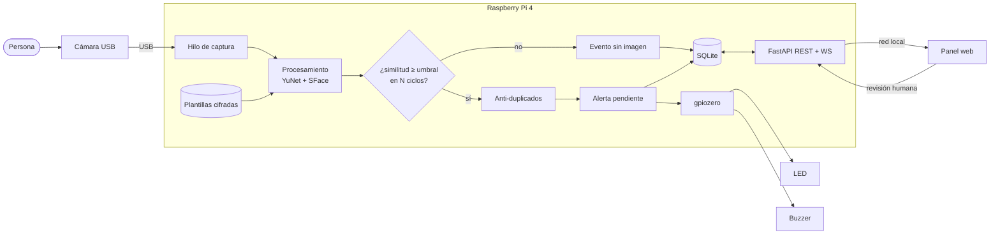

# FaceGuard AI

**Sistema IoT de alerta temprana por reconocimiento facial para el ingreso de edificios y condominios, que funciona 100 % en una Raspberry Pi 4.**

Una cámara USB vigila la entrada. La Raspberry Pi detecta los rostros y los compara, sin Internet, con una lista de personas que tienen una restricción de ingreso documentada. Si encuentra una posible coincidencia, avisa al guardia de portería con una notificación en el panel web, un LED rojo y un buzzer. **El sistema solo avisa: una persona revisa cada alerta y decide qué hacer.**


| | |
|---|---|
| **Plataforma** | Raspberry Pi 4 Model B · Raspberry Pi OS 64-bit |
| **Sensor** | Cámara web USB |
| **Actuadores** | LED rojo (GPIO17) y buzzer (GPIO27) |
| **Comunicación** | Red local: API REST, WebSocket y video MJPEG por HTTP |
| **Respuesta** | Alerta en tiempo real, alarma física, panel de revisión e historial |
| **IA** | OpenCV · YuNet (detección) + SFace/MobileFaceNet (reconocimiento), procesamiento local |
| **Software** | Python 3 · FastAPI · SQLite · React · TypeScript · Tailwind CSS · Recharts |

---

## Contenido

1. [El problema](#1-el-problema)
2. [La solución](#2-la-solución)
3. [Arquitectura y flujo de datos](#3-arquitectura-y-flujo-de-datos)
4. [Componentes](#4-componentes)
5. [Costo estimado y viabilidad](#5-costo-estimado-y-viabilidad)
6. [Instalación y puesta en marcha](#6-instalación-y-puesta-en-marcha)
7. [Uso del sistema](#7-uso-del-sistema)
8. [Pruebas](#8-pruebas)
9. [Seguridad y privacidad](#9-seguridad-y-privacidad)
10. [Aporte creativo del grupo](#10-aporte-creativo-del-grupo)
11. [Estructura del repositorio](#11-estructura-del-repositorio)
12. [Referencias y créditos](#12-referencias-y-créditos)
13. [Presentación y equipo](#13-presentación-y-equipo)

---

## 1. El problema

En muchos edificios y condominios hay personas con una **prohibición de ingreso documentada**: alguien con una orden judicial de alejamiento solicitada por un residente, un exempleado que causó daños, o una persona denunciada por robos en áreas comunes. Hoy, el control depende de que el guardia de turno **recuerde las caras** a partir de una foto pegada en la portería.

**¿A quién afecta?**
- A los **residentes**, especialmente a quienes tienen una orden de protección: su seguridad depende de la memoria de un guardia.
- Al **personal de seguridad**: trabaja por turnos, cambia con frecuencia y vigila muchas personas por hora. Es imposible reconocer a todos.
- A la **administración del condominio**: no tiene un registro confiable de qué pasó, cuándo y quién lo revisó.

**¿Por qué es importante?** Un ingreso no detectado puede terminar en un robo, en violencia o en el incumplimiento de una orden de protección. Además, “listas negras” en papel, sin fecha de vencimiento ni control, suelen ser injustas: nadie revisa si siguen vigentes ni quién las consulta.

## 2. La solución

FaceGuard AI convierte la Raspberry Pi en un **asistente para el guardia**, no en un reemplazo:

1. **Capta** — la cámara USB transmite el video de la entrada a la Raspberry Pi.
2. **Procesa en el borde (edge)** — la Pi detecta rostros 4 veces por segundo y calcula una “huella” numérica de 128 valores por rostro. La compara con las personas de la lista, cuyas fotos y huellas están **cifradas**.
3. **Comunica** — por la red local, publica el video con los recuadros, el estado del equipo y los eventos al panel web, en tiempo real por WebSocket.
4. **Responde** —
   - **Sin coincidencia:** recuadro verde y un evento agrupado **sin imagen** (no se guardan fotos de quienes pasan).
   - **Posible coincidencia:** si la similitud supera el umbral en varios fotogramas seguidos, se crea una alerta “Pendiente de revisión”, aparece una notificación en el panel, el **LED parpadea** y suena el **buzzer** (según el nivel: bajo, medio o alto).
   - **Revisión humana:** el guardia ve lado a lado la imagen detectada y la foto registrada. Marca la alerta como *confirmada*, *falso positivo* o *cerrada*, con sus observaciones.


### Funciones principales

| Módulo | Qué hace |
|---|---|
| **Dashboard** | Estado de la Pi (CPU, RAM, temperatura, encendido), cámara, motor facial, GPIO, contadores, gráficas de 24 h y 7 días, últimas detecciones; todo se actualiza solo |
| **Monitoreo en vivo** | Video con recuadros (verde, ámbar, rojo), FPS, latencia, iniciar/detener, resolución, capturas autorizadas con motivo |
| **Lista de alerta** | Alta, edición y baja con foto, **validación automática de la calidad de la foto**, motivo y base legal obligatorios, nivel, vencimiento, historial de cambios, búsqueda y filtros |
| **Alertas** | Bandeja por estado, revisión lado a lado, observaciones obligatorias, alertas de prueba |
| **Historial** | Filtros por fecha, tipo, nivel, estado y origen; vista detallada; exportación a **PDF y CSV** |
| **Usuarios** | 4 roles: superadministrador, administrador, operador y auditor |
| **Auditoría** | Registro de inicios de sesión, cambios, exportaciones y cada visualización de una imagen |
| **Configuración** | Umbral, confirmación, frecuencia, cámara, LED/buzzer (con botón de prueba), periodos de conservación, información del sistema, registros, reinicio del motor |
| **Modo demostración** | Video y detecciones simuladas, registros ficticios y alertas de prueba, siempre marcados como **SIMULADO** |

## 3. Arquitectura y flujo de datos


<details>
<summary>Versión Mermaid (se dibuja en GitHub)</summary>


</details>

**Decisiones de diseño:**

- **Captura y procesamiento en hilos separados.** La cámara entrega ~15 fps, pero el análisis corre a 4 por segundo sobre el fotograma más reciente. Así la Pi no se satura y el video se ve fluido.
- **Procesamiento local (edge).** Las imágenes no salen del edificio y el sistema sigue funcionando sin Internet.
- **La Raspberry Pi es el dispositivo intermediario de red.** Recibe el video por USB y publica el panel en la red local (Wi-Fi o Ethernet), donde lo abre el guardia desde una PC, tablet o celular. Más detalles en [docs/hardware.md](docs/hardware.md).
- **El frontend se compila como archivos estáticos.** FastAPI los sirve, así que no hay un servidor Node consumiendo recursos en la Pi.
- **Base de datos con migraciones versionadas** (`backend/migrations/NNN_*.sql`) para actualizar el esquema sin perder datos.

## 4. Componentes

### Hardware

| Componente | Función |
|---|---|
| Raspberry Pi 4 Model B (8 GB) | Cerebro del sistema: visión artificial, base de datos y servidor web |
| Cámara web USB 1080p | Sensor que capta la entrada |
| microSD 32 GB (A1/A2) | Sistema operativo y datos |
| Fuente oficial USB-C 5,1 V 3 A | Alimentación estable |
| Case con disipador y ventilador | Control térmico en uso 24/7 |
| LED rojo + resistencia de 330 Ω | Alerta visual en portería |
| Módulo buzzer activo (KY-012 o similar) | Alerta sonora |
| Protoboard y cables dupont | Conexiones |

Diagrama de conexión de los pines y ubicación de la cámara: **[docs/hardware.md](docs/hardware.md)**.

### Software

| Capa | Tecnología |
|---|---|
| Visión | OpenCV 4.8+ (`FaceDetectorYN`, `FaceRecognizerSF`), modelos ONNX de OpenCV Zoo |
| Backend | Python 3.11+, FastAPI, Uvicorn, WebSockets, SQLite (modo WAL) |
| Seguridad | `cryptography` (Fernet), scrypt, sesiones con cookie httpOnly, control de acceso por roles |
| Hardware | gpiozero + lgpio, psutil |
| Reportes | ReportLab (PDF), CSV |
| Frontend | React 18, TypeScript, Tailwind CSS, Recharts, Lucide Icons, TanStack Query |
| Despliegue | systemd con endurecimiento, script de instalación |

## 5. Costo estimado y viabilidad

### Costo de los componentes (precios de referencia en USD, octubre de 2026)

| Componente | Cant. | Costo aprox. (USD) |
|---|:-:|---:|
| Raspberry Pi 4 Model B 8 GB | 1 | 165,00 |
| Cámara web USB 1080p | 1 | 25,00 |
| microSD 32 GB A1 | 1 | 12,00 |
| Fuente oficial USB-C 5,1 V 3 A | 1 | 8,00 |
| Case con disipador y ventilador | 1 | 12,00 |
| LED, resistencias, módulo buzzer, protoboard y cables | 1 | 6,00 |
| **Total (precio internacional)** | | **≈ 228,00** |
| Total estimado en Bolivia (importación y margen +20–40 %) | | ≈ 275–320 |

- El precio de la Raspberry Pi 4 de 8 GB es el precio de lista **después de las subidas por el costo de la memoria RAM en diciembre de 2025, febrero de 2026 y abril de 2026**: pasó de USD 75 en su lanzamiento a USD 165 ([Raspberry Pi, abril de 2026](https://www.raspberrypi.com/news/a-new-3gb-raspberry-pi-4-for-83-75-and-more-memory-driven-price-increases/); [Liliputing](https://liliputing.com/?p=198888)). Los demás precios son referencias de tiendas en línea. **El grupo debe reemplazarlos con cotizaciones locales** (La Paz, Cochabamba o Santa Cruz).
- **Software: USD 0.** Todo es de código abierto y los modelos tienen licencia Apache 2.0. No hay suscripciones ni servicios en la nube.

### Costos de operación

| Concepto | Estimación |
|---|---|
| Energía (Pi + cámara, 5–7 W, 24 h) | ≈ 4–5 kWh al mes: un costo marginal en la factura del condominio |
| Internet | No es necesario |
| Mantenimiento | Revisión mensual de la lista y los vencimientos (≈ 1 h de la administración) y reemplazo de la microSD cada 2–3 años |
| Capacitación | 1 sesión de 1 h para los guardias sobre el protocolo de revisión |

### Análisis de viabilidad

**Es viable para un condominio mediano.**
- Un condominio de 40 departamentos paga **≈ USD 7–8 por departamento, una sola vez**.
- Los sistemas comerciales de reconocimiento facial con grabador (NVR) o servicios en la nube suelen costar varias veces más e incluir pagos mensuales. Además, envían las imágenes fuera del edificio.

**Hallazgo del grupo: la Pi de 8 GB está sobredimensionada.** En nuestras pruebas, el proceso completo (servidor, modelos y video) usó **≈ 355 MB de RAM**. Una **Raspberry Pi 4 de 4 GB (USD 100)** o la nueva **de 3 GB (USD 83,75)** alcanzan y reducen el costo total a ≈ USD 145–165. Se mantiene la de 8 GB porque es la placa disponible para el prototipo.

**Límites de la viabilidad:**
- **Una cámara por Pi.** Para varias entradas, se necesita una Pi por acceso o un equipo más potente.
- **Requiere un guardia o administrador** que revise las alertas: el sistema no es autónomo.
- **Condiciones de uso:** necesita aprobación de la asamblea de copropietarios, un letrero informativo y un reglamento interno (ver [seguridad y privacidad](docs/seguridad-privacidad.md)).
- **Iluminación:** con contraluz o de noche se necesita una luz frontal.

## 6. Instalación y puesta en marcha

### Opción A — Probar en una computadora (sin Raspberry Pi)

Requisitos: Python 3.11+ y Git (Node.js 18+ solo si va a modificar el frontend).

```bash
git clone <URL-de-este-repositorio> faceguard-ai
cd faceguard-ai

# 1. Backend
cd backend
python3 -m venv .venv && source .venv/bin/activate      # Windows: .venv\Scripts\activate
pip install -r requirements.txt
bash scripts/download_models.sh                         # o descargue los 2 .onnx manualmente a backend/models/

# 2. Frontend: ya viene compilado en frontend/dist. Para recompilarlo:
#    cd ../frontend && npm install && npm run build

# 3. Ejecutar
cd ../backend
FACEGUARD_ADMIN_PASSWORD=CambiarEsto123 uvicorn app.main:app --port 8000
```

Abra **http://localhost:8000** e ingrese con el usuario `admin` y la contraseña que definió. El sistema le pedirá cambiarla.

> **Sin cámara:** vaya a *Configuración → Demostración* y active **Video y detecciones simuladas**. Después pulse **Cargar registros y eventos ficticios**.
> **Con un video de prueba:** `FACEGUARD_CAMERA_SOURCE=ruta/al/video.mp4 uvicorn app.main:app`
> **Modo desarrollo del frontend:** `cd frontend && npm run dev` (http://localhost:5173, con proxy al backend en el puerto 8000).

### Opción B — Raspberry Pi 4 (prototipo)

1. Grabe **Raspberry Pi OS (64-bit) Lite o Desktop** con Raspberry Pi Imager. Active SSH y configure el Wi-Fi.
2. Conecte la cámara USB, el LED y el buzzer según [docs/hardware.md](docs/hardware.md).
3. El repositorio ya incluye el frontend compilado (`frontend/dist`), así que **no hace falta Node.js en la Pi**. Solo si modifica el frontend, recompílelo en su computadora con `cd frontend && npm ci && npm run build` y vuelva a copiarlo.
4. Instale el servicio:
   ```bash
   sudo ./deploy/install.sh
   ```
   Este script crea el usuario de servicio `faceguard`, el entorno de Python y la carpeta de datos `/var/lib/faceguard` (permisos 700). También descarga y verifica los modelos y activa el servicio **systemd**, que arranca solo al encender la Pi y se reinicia si falla.
5. Obtenga la contraseña inicial: `sudo cat /var/lib/faceguard/secret/initial_admin.txt` (borre el archivo después).
6. Desde un equipo de la misma red, abra `http://<IP-de-la-Pi>:8000`.

Comandos útiles:

```bash
sudo systemctl status faceguard          # estado
sudo journalctl -u faceguard -f          # registros en vivo
sudo nano /etc/faceguard/faceguard.env   # configuración del servicio
cd /opt/faceguard-ai/backend && sudo -u faceguard FACEGUARD_DATA_DIR=/var/lib/faceguard \
  ../venv/bin/python -m scripts.manage create-user guardia1 "Guardia Turno Noche" operator
```

### Variables de entorno

| Variable | Por defecto | Descripción |
|---|---|---|
| `FACEGUARD_DATA_DIR` | `backend/data` | Base de datos, clave de cifrado, fotos y registros |
| `FACEGUARD_MODELS_DIR` | `backend/models` | Modelos ONNX |
| `FACEGUARD_ADMIN_PASSWORD` | aleatoria | Contraseña temporal de `admin` en el primer arranque |
| `FACEGUARD_CAMERA_NAME` | `CAM-01 Entrada principal` | Nombre que aparece en eventos y reportes |
| `FACEGUARD_CAMERA_SOURCE` | — | Video o URL RTSP en lugar de la cámara USB (para pruebas) |
| `FACEGUARD_SECURE_COOKIES` | `0` | `1` si se sirve por HTTPS |
| `FACEGUARD_SESSION_HOURS` | `8` | Duración de la sesión |

La documentación interactiva de la API está en `http://<host>:8000/api/docs`.

## 7. Uso del sistema

1. **Registrar a una persona** (administrador): *Lista de alerta → Nuevo registro*. Suba una foto frontal; el sistema verifica que tenga un solo rostro, el tamaño, la nitidez y la iluminación. Complete el motivo, la base legal, el nivel y la fecha de vencimiento, y confirme.
2. **Monitorear** (operador): *Monitoreo en vivo*. Recuadro verde = sin coincidencia; ámbar = verificando; rojo = posible coincidencia.
3. **Revisar una alerta** (operador): llega una notificación y suena el buzzer → *Revisar alerta*. Compare las imágenes, verifique en persona, escriba las observaciones y marque *Confirmar coincidencia*, *Falso positivo* o *Cerrar*.
4. **Consultar y exportar** (administrador o auditor): *Historial*, con filtros y exportación a PDF o CSV.

| | |
|---|---|
|  |  |
|  |  |

### Roles y permisos

| Permiso | Superadmin | Admin | Operador | Auditor |
|---|:-:|:-:|:-:|:-:|
| Dashboard | ✅ | ✅ | ✅ | ✅ |
| Video en vivo y capturas | ✅ | ✅ | ✅ | — |
| Revisar alertas (con imágenes) | ✅ | ✅ | ✅ | solo consulta, sin imágenes |
| Ver la lista de alerta | ✅ | ✅ | — | ✅ (sin fotos) |
| Crear, editar o eliminar registros | ✅ | ✅ | — | — |
| Historial / exportar | ✅ / ✅ | ✅ / ✅ | ✅ / — | ✅ / ✅ |
| Auditoría | ✅ | — | — | ✅ |
| Configuración | ✅ | solo consulta | — | — |
| Usuarios | ✅ | — | — | — |

## 8. Pruebas

La evidencia completa está en **[docs/pruebas.md](docs/pruebas.md)**. Resumen:

| Prueba | Resultado esperado | Resultado obtenido | Ajuste |
|---|---|---|---|
| **A. Persona no registrada** | Sin alerta, sin imagen guardada | Similitud −0,05; 1 evento agrupado, 0 imágenes, 0 alertas | Se guarda “—” en lugar de 0,00 cuando la lista está vacía |
| **B. Persona registrada** | 1 alerta, LED + buzzer, notificación | Similitud 0,95; **1 sola alerta** aunque la persona apareció varias veces; alarma activada | El primer intento falló porque el rostro era muy pequeño (40 px): se documentó la distancia de la cámara y el tamaño mínimo es configurable |
| **C. Robustez** | La misma persona coincide; otras no | Variaciones (luz, giro, ruido, desenfoque): 0,83–0,96; otras personas: −0,05 y 0,13 | Umbral fijado en 0,42 |
| **D. Cámara desconectada** | No se cae; reintenta | Reintentos progresivos; el panel muestra “Sin señal” | Evento de sistema con un límite de 1 cada 30 s |
| **Automáticas** | — | **16/16 aprobadas** (`pytest`) | — |

Para ejecutar las pruebas automáticas: `cd backend && pip install -r requirements-dev.txt scikit-image && pytest -v`

> ⚠️ **Pendiente para el grupo:** completar en la Raspberry Pi la tabla de pruebas físicas F1–F7 de [docs/pruebas.md](docs/pruebas.md#3-pruebas-físicas-en-la-raspberry-pi-completar-en-la-demostración) (LED y buzzer reales, temperatura, FPS) y agregar fotos o videos del prototipo en `docs/img/`.

## 9. Seguridad y privacidad

Los riesgos y las medidas están detallados en **[docs/seguridad-privacidad.md](docs/seguridad-privacidad.md)**. En resumen:

- **Revisión humana obligatoria:** ninguna alerta dispara acciones automáticas contra una persona.
- **Cifrado** de fotos, plantillas biométricas y capturas (Fernet). La clave nunca sale de la Pi.
- **Mínimo de datos:** no se guardan imágenes de personas sin coincidencia. Los eventos, las imágenes y los registros vencen y se borran automáticamente.
- **Control de acceso:** 4 roles, contraseñas con scrypt, bloqueo por intentos fallidos, cambio obligatorio de la contraseña inicial y sesiones seguras.
- **Auditoría** de todas las acciones administrativas, incluso de cada vez que alguien abre una imagen.
- **Funciona sin Internet** y dentro de la red local; el servicio corre con un usuario sin privilegios y con systemd endurecido.
- **Límites reconocidos:** posibles sesgos del modelo, no detecta fotos impresas o en pantalla, y Bolivia aún no tiene una ley general de protección de datos.

## 10. Aporte creativo del grupo

Partimos de los ejemplos de OpenCV Zoo, que solo comparan dos imágenes, y de los tutoriales típicos de “reconocimiento facial con Raspberry Pi”, que abren una puerta o muestran un nombre. Lo que **diseñamos y cambiamos**:

1. **Otro propósito:** de “identificar a todos” a una **lista de alerta acotada**, con base legal obligatoria, vencimiento y revisión humana. El sistema no identifica a los residentes ni a los visitantes comunes.
2. **Menos falsos positivos:** confirmación temporal en N fotogramas, umbral calibrado con pruebas, tamaño mínimo de rostro y **validación automática de la calidad de la foto** al registrar.
3. **Anti-duplicados** por persona y agrupación de detecciones, para no saturar al guardia ni la base de datos.
4. **Alarma física graduada por nivel** (LED rápido o lento, buzzer desde el nivel configurado), con un botón de prueba y un modo simulado si no hay GPIO.
5. **Privacidad por diseño:** cifrado, retención automática, auditoría de cada imagen vista y ninguna foto guardada de quien no coincide.
6. **Panel tipo centro de operaciones de seguridad (SOC)** en tiempo real, con 4 roles, exportaciones y modo demostración claramente marcado.
7. **Optimización para la Pi:** hilos separados de captura y procesamiento, frecuencia y resolución configurables, frontend estático y servicio systemd con límites de CPU y memoria.
8. **Análisis de costos** con precios actualizados, que muestra que una Pi de 3–4 GB alcanza.

## 11. Estructura del repositorio

```
faceguard-ai/
├── backend/
│   ├── app/
│   │   ├── main.py              # FastAPI: arranque, WebSocket, cabeceras de seguridad, frontend estático
│   │   ├── config.py            # configuración por variables de entorno
│   │   ├── core/                # base de datos y migraciones, seguridad (auth/RBAC), cifrado, auditoría
│   │   ├── api/                 # rutas: auth, dashboard, cámara, lista, eventos/alertas, administración
│   │   └── services/            # cámara, motor facial, pipeline, GPIO, tiempo real, retención, demo
│   ├── migrations/              # esquema SQL versionado
│   ├── scripts/                 # descarga de modelos, gestión de usuarios, benchmark del motor
│   ├── tests/                   # 16 pruebas automáticas (pytest)
│   └── requirements.txt
├── frontend/                    # React + TypeScript + Tailwind (se compila a frontend/dist)
│   └── src/{pages,components,lib}
├── deploy/                      # servicio systemd, script de instalación, variables de entorno
└── docs/
    ├── img/                     # capturas y diagrama de arquitectura
    ├── diagramas/               # fuente Mermaid del diagrama
    ├── evidencias/              # salidas de las pruebas
    ├── pruebas.md               # evidencia de pruebas
    ├── hardware.md              # conexiones GPIO y ubicación de la cámara
    ├── seguridad-privacidad.md  # riesgos y medidas
    └── presentacion/            # ← diapositivas o póster del grupo
```

## 12. Referencias y créditos

| Recurso | Uso en el proyecto | Qué hicimos nosotros |
|---|---|---|
| [OpenCV Zoo — YuNet](https://github.com/opencv/opencv_zoo/tree/main/models/face_detection_yunet) (Apache 2.0) | Modelo de detección facial `face_detection_yunet_2023mar.onnx` | Lo usamos sin modificar el modelo. Agregamos el escalado de la imagen, el filtro de tamaño mínimo y la confianza configurable |
| [OpenCV Zoo — SFace](https://github.com/opencv/opencv_zoo/tree/main/models/face_recognition_sface) (Apache 2.0) | Modelo de reconocimiento `face_recognition_sface_2021dec.onnx`: una MobileFaceNet entrenada con la función de pérdida SFace | Lo usamos sin modificar el modelo. Seguimos el flujo de su demo oficial (alinear con 5 puntos → extraer la plantilla → similitud coseno) y diseñamos la galería en memoria, la comparación vectorizada, la confirmación temporal y el umbral calibrado |
| Zhong et al., *SFace: Sigmoid-Constrained Hypersphere Loss for Robust Face Recognition*, IEEE TIP 2021 | Fundamento del modelo de reconocimiento | — |
| Wu et al., *YuNet: A Tiny Millisecond-level Face Detector*, Machine Intelligence Research 2023 | Fundamento del modelo de detección | — |
| [Documentación de OpenCV](https://docs.opencv.org/4.x/d0/dd4/tutorial_dnn_face.html) — `FaceDetectorYN` y `FaceRecognizerSF` | API de detección y reconocimiento, umbral coseno de referencia (0,363) | Ajustamos el umbral a 0,42 a partir de nuestras pruebas |
| [FastAPI](https://fastapi.tiangolo.com/) | Framework web, WebSocket, dependencias de seguridad | Diseño propio de la API y del control de acceso por roles |
| [gpiozero](https://gpiozero.readthedocs.io/) | Control del LED y el buzzer | Patrones de alarma por nivel y modo simulado |
| [cryptography — Fernet](https://cryptography.io/en/latest/fernet/) | Cifrado de datos biométricos | — |
| [React](https://react.dev/), [Tailwind CSS](https://tailwindcss.com/), [Recharts](https://recharts.org/), [Lucide](https://lucide.dev/), [TanStack Query](https://tanstack.com/query) | Interfaz | Diseño visual y todas las pantallas propias |
| [ReportLab](https://www.reportlab.com/) | Exportación a PDF | — |
| Fuentes Inter y JetBrains Mono ([Fontsource](https://fontsource.org/), licencia OFL) | Tipografía incluida localmente (funciona sin Internet) | — |
| Imagen *Astronaut* (NASA, dominio público, vía `scikit-image`) | Persona de prueba en pruebas automáticas y capturas | No se usaron fotos de personas sin su consentimiento |
| [Raspberry Pi — aumento de precios, abril de 2026](https://www.raspberrypi.com/news/a-new-3gb-raspberry-pi-4-for-83-75-and-more-memory-driven-price-increases/) y [Liliputing](https://liliputing.com/?p=198888) | Precios para el análisis de costos | — |
| **Claude (Anthropic), asistente de IA** | Ayudó a generar código, documentación y pruebas a partir de la especificación escrita por el grupo | **El grupo debe describir aquí qué revisó, probó, modificó y decidió por su cuenta** (ver la sección 13) |

## 13. Presentación y equipo

- **Presentación o póster:** coloque el archivo en [`docs/presentacion/`](docs/presentacion/) y enlácelo aquí.
- **Video de la demostración (opcional):** enlace aquí.

| Integrante | Contribución personal |
|---|---|
| _Nombre 1_ | _p. ej., armado del hardware, conexión GPIO y pruebas F1–F7_ |
| _Nombre 2_ | _p. ej., calibración del umbral y pruebas de reconocimiento_ |
| _Nombre 3_ | _p. ej., análisis de costos, seguridad y privacidad, presentación_ |

---

<sub>FaceGuard AI es un prototipo académico. Antes de usarlo en un edificio real se necesita autorización de la asamblea de copropietarios, señalización visible y asesoría legal.</sub>
