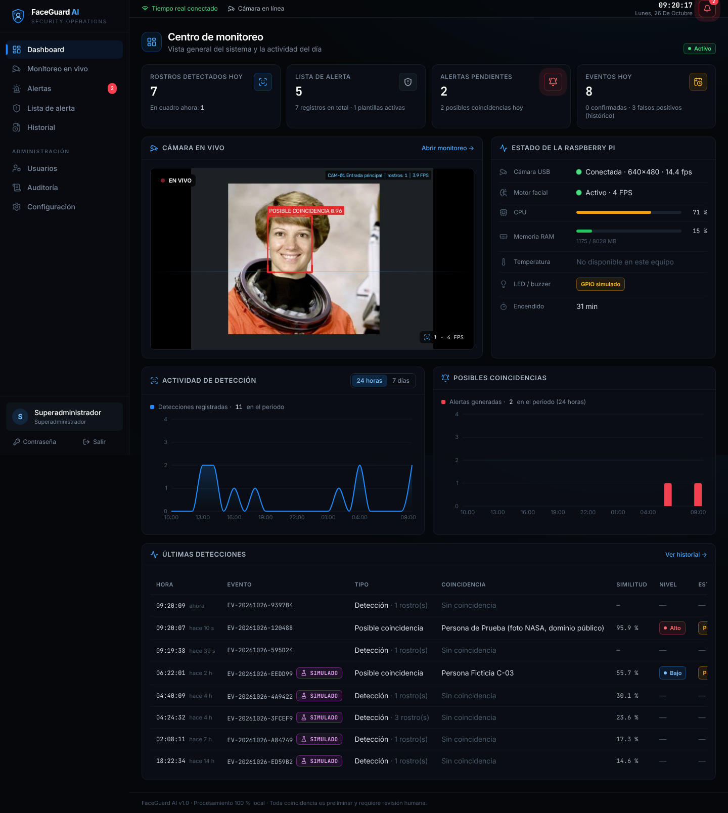
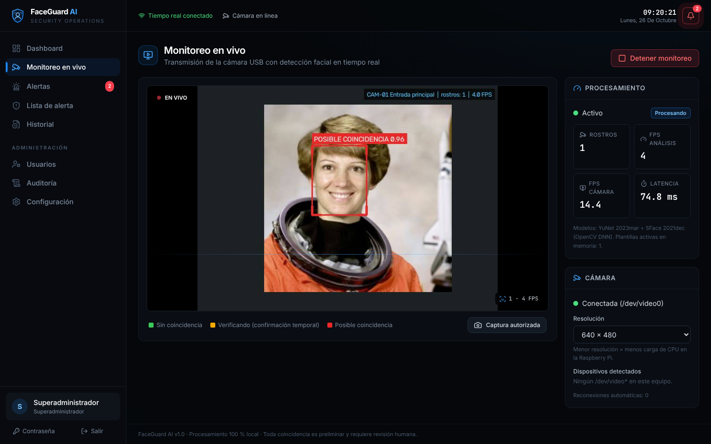
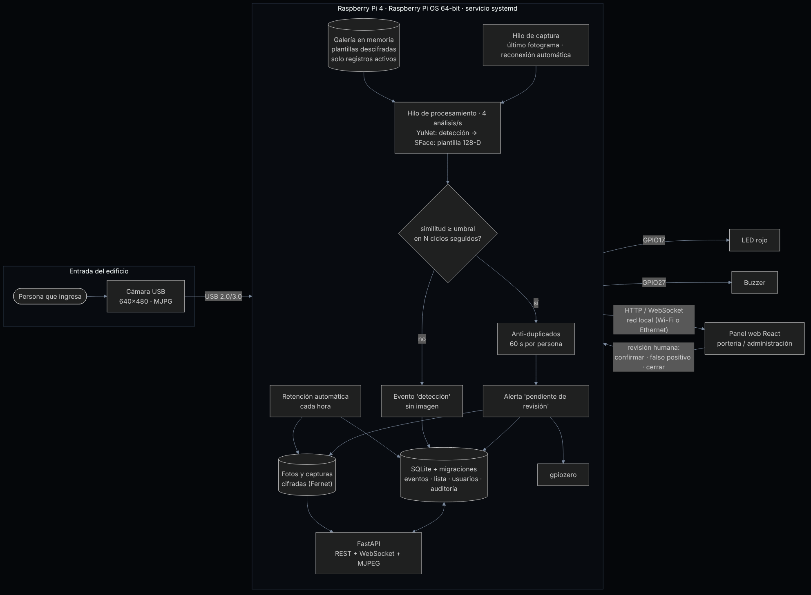
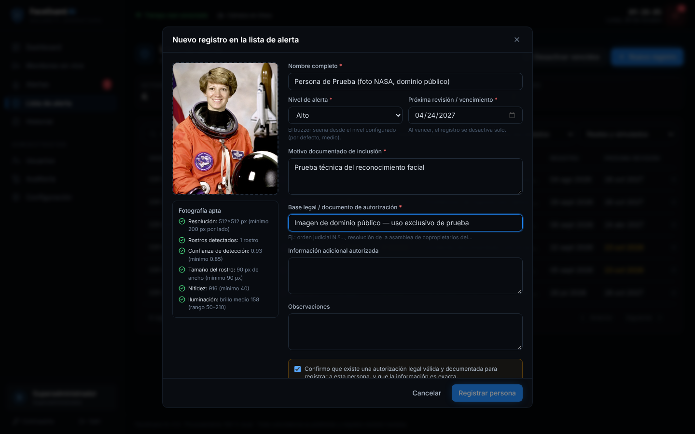
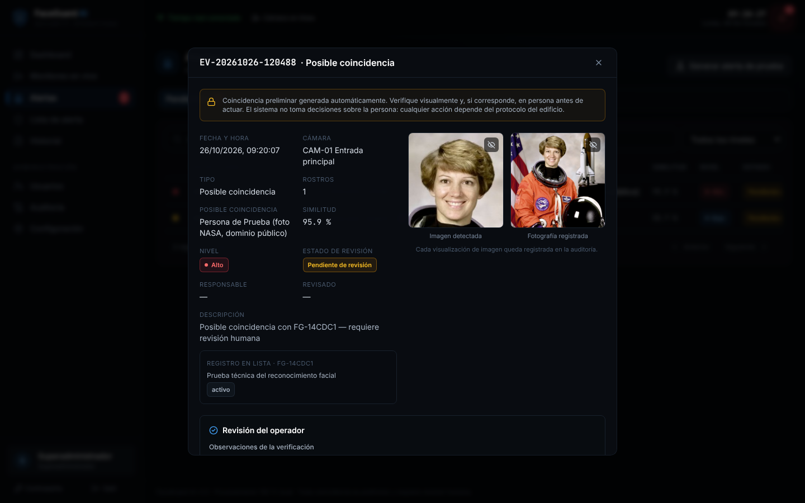
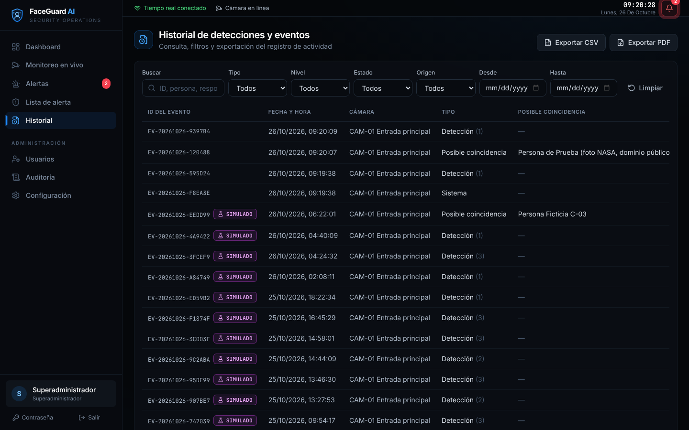
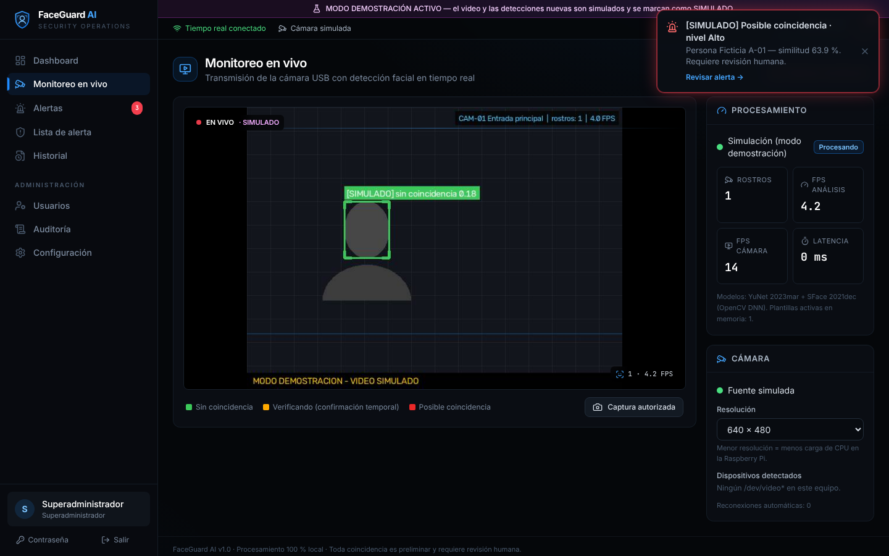

# FaceGuard AI

**Sistema IoT de alerta temprana por reconocimiento facial para el ingreso de edificios y condominios, que funciona 100 % en una Raspberry Pi 4 y también en una PC con Windows 10/11.**

Una cámara USB vigila la entrada. La Raspberry Pi detecta los rostros y los compara, sin Internet, con una lista de personas que tienen una restricción de ingreso documentada. Si encuentra una posible coincidencia, avisa al guardia de portería con una notificación en el panel web, un LED rojo y un buzzer. **El sistema solo avisa: una persona revisa cada alerta y decide qué hacer.**



| | |
|---|---|
| **Plataforma** | Raspberry Pi 4 Model B · Raspberry Pi OS 64-bit — también Windows 10/11 (64 bits), con la misma base de código |
| **Sensor** | Cámara web USB o webcam integrada |
| **Actuadores** | LED rojo (GPIO17) y buzzer (GPIO27) |
| **Comunicación** | Red local: API REST, WebSocket y video MJPEG por HTTP |
| **Respuesta** | Alerta en tiempo real, alarma física, panel de revisión e historial |
| **IA** | OpenCV · YuNet (detección) + SFace/MobileFaceNet (reconocimiento), procesamiento local |
| **Software** | Python 3 · FastAPI · SQLite · React · TypeScript · Tailwind CSS · Recharts |

---

## Contenido

1. [El problema](#1-el-problema)
2. [La solución](#2-la-solución)
3. [Arquitectura y flujo de datos](#3-arquitectura-y-flujo-de-datos)
4. [Componentes](#4-componentes)
5. [Costo estimado y viabilidad](#5-costo-estimado-y-viabilidad)
6. [Instalación y puesta en marcha](#6-instalación-y-puesta-en-marcha) — [Windows 10/11](#61-windows-10--windows-11) · [Raspberry Pi OS](#62-raspberry-pi-os)
7. [Uso del sistema](#7-uso-del-sistema)
8. [Pruebas](#8-pruebas)
9. [Seguridad y privacidad](#9-seguridad-y-privacidad)
10. [Aporte creativo del grupo](#10-aporte-creativo-del-grupo)
11. [Estructura del repositorio](#11-estructura-del-repositorio)
12. [Referencias y créditos](#12-referencias-y-créditos)
13. [Presentación y equipo](#13-presentación-y-equipo)

---

## 1. El problema

En muchos edificios y condominios hay personas con una **prohibición de ingreso documentada**: alguien con una orden judicial de alejamiento solicitada por un residente, un exempleado que causó daños, o una persona denunciada por robos en áreas comunes. Hoy, el control depende de que el guardia de turno **recuerde las caras** a partir de una foto pegada en la portería.

**¿A quién afecta?**
- A los **residentes**, especialmente a quienes tienen una orden de protección: su seguridad depende de la memoria de un guardia.
- Al **personal de seguridad**: trabaja por turnos, cambia con frecuencia y vigila muchas personas por hora. Es imposible reconocer a todos.
- A la **administración del condominio**: no tiene un registro confiable de qué pasó, cuándo y quién lo revisó.

**¿Por qué es importante?** Un ingreso no detectado puede terminar en un robo, en violencia o en el incumplimiento de una orden de protección. Además, “listas negras” en papel, sin fecha de vencimiento ni control, suelen ser injustas: nadie revisa si siguen vigentes ni quién las consulta.

## 2. La solución

FaceGuard AI convierte la Raspberry Pi en un **asistente para el guardia**, no en un reemplazo:

1. **Capta** — la cámara USB transmite el video de la entrada a la Raspberry Pi.
2. **Procesa en el borde (edge)** — la Pi detecta rostros 4 veces por segundo y calcula una “huella” numérica de 128 valores por rostro. La compara con las personas de la lista, cuyas fotos y huellas están **cifradas**.
3. **Comunica** — por la red local, publica el video con los recuadros, el estado del equipo y los eventos al panel web, en tiempo real por WebSocket.
4. **Responde** —
   - **Sin coincidencia:** recuadro verde y un evento agrupado **sin imagen** (no se guardan fotos de quienes pasan).
   - **Posible coincidencia:** si la similitud supera el umbral en varios fotogramas seguidos, se crea una alerta “Pendiente de revisión”, aparece una notificación en el panel, el **LED parpadea** y suena el **buzzer** (según el nivel: bajo, medio o alto).
   - **Revisión humana:** el guardia ve lado a lado la imagen detectada y la foto registrada. Marca la alerta como *confirmada*, *falso positivo* o *cerrada*, con sus observaciones.



### Funciones principales

| Módulo | Qué hace |
|---|---|
| **Dashboard** | Estado de la Pi (CPU, RAM, temperatura, encendido), cámara, motor facial, GPIO, contadores, gráficas de 24 h y 7 días, últimas detecciones; todo se actualiza solo |
| **Monitoreo en vivo** | Video con recuadros (verde, ámbar, rojo), FPS, latencia, iniciar/detener, resolución, capturas autorizadas con motivo |
| **Personas y blacklist** | Personas autorizadas y no autorizadas con varias fotos, aviso de posibles duplicados, análisis de fotografías y alertas. Alta, edición y baja con foto, **validación automática de la calidad de la foto**, motivo y base legal obligatorios, nivel, vencimiento, historial de cambios, búsqueda y filtros |
| **Alertas** | Bandeja por estado, revisión lado a lado, observaciones obligatorias, alertas de prueba |
| **Historial** | Filtros por fecha, tipo, nivel, estado y origen; vista detallada; exportación a **PDF y CSV** |
| **Usuarios** | 4 roles: superadministrador, administrador, operador y auditor |
| **Auditoría** | Registro de inicios de sesión, cambios, exportaciones y cada visualización de una imagen |
| **Configuración** | Umbral, confirmación, frecuencia, cámara, LED/buzzer (con botón de prueba), periodos de conservación, información del sistema, registros, reinicio del motor |
| **Modo demostración** | Video y detecciones simuladas, registros ficticios y alertas de prueba, siempre marcados como **SIMULADO** |

## 3. Arquitectura y flujo de datos



<details>
<summary>Versión Mermaid (se dibuja en GitHub)</summary>


</details>

**Decisiones de diseño:**

- **Captura y procesamiento en hilos separados.** La cámara entrega ~15 fps, pero el análisis corre a 4 por segundo sobre el fotograma más reciente. Así la Pi no se satura y el video se ve fluido.
- **Procesamiento local (edge).** Las imágenes no salen del edificio y el sistema sigue funcionando sin Internet.
- **La Raspberry Pi es el dispositivo intermediario de red.** Recibe el video por USB y publica el panel en la red local (Wi-Fi o Ethernet), donde lo abre el guardia desde una PC, tablet o celular. Más detalles en [docs/hardware.md](docs/hardware.md).
- **El frontend se compila como archivos estáticos.** FastAPI los sirve, así que no hay un servidor Node consumiendo recursos en la Pi.
- **Base de datos con migraciones versionadas** (`backend/migrations/NNN_*.sql`) para actualizar el esquema sin perder datos.

## 4. Componentes

### Hardware

| Componente | Función |
|---|---|
| Raspberry Pi 4 Model B (8 GB) | Cerebro del sistema: visión artificial, base de datos y servidor web |
| Cámara web USB 1080p | Sensor que capta la entrada |
| microSD 32 GB (A1/A2) | Sistema operativo y datos |
| Fuente oficial USB-C 5,1 V 3 A | Alimentación estable |
| Case con disipador y ventilador | Control térmico en uso 24/7 |
| LED rojo + resistencia de 330 Ω | Alerta visual en portería |
| Módulo buzzer activo (KY-012 o similar) | Alerta sonora |
| Protoboard y cables dupont | Conexiones |

Diagrama de conexión de los pines y ubicación de la cámara: **[docs/hardware.md](docs/hardware.md)**.

### Software

| Capa | Tecnología |
|---|---|
| Visión | OpenCV 4.8+ (`FaceDetectorYN`, `FaceRecognizerSF`), modelos ONNX de OpenCV Zoo |
| Backend | Python 3.11+, FastAPI, Uvicorn, WebSockets, SQLite (modo WAL) |
| Seguridad | `cryptography` (Fernet), scrypt, sesiones con cookie httpOnly, control de acceso por roles |
| Hardware | gpiozero + lgpio (Raspberry Pi; simulado en Windows), psutil |
| Reportes | ReportLab (PDF), CSV |
| Frontend | React 18, TypeScript, Tailwind CSS, Recharts, Lucide Icons, TanStack Query |
| Despliegue | Raspberry Pi: systemd con endurecimiento y `install.sh` · Windows: `setup.ps1` y `run.ps1` (PowerShell) |

## 5. Costo estimado y viabilidad

### Costo de los componentes (precios de referencia en USD, octubre de 2026)

| Componente | Cant. | Costo aprox. (USD) |
|---|:-:|---:|
| Raspberry Pi 4 Model B 8 GB | 1 | 165,00 |
| Cámara web USB 1080p | 1 | 25,00 |
| microSD 32 GB A1 | 1 | 12,00 |
| Fuente oficial USB-C 5,1 V 3 A | 1 | 8,00 |
| Case con disipador y ventilador | 1 | 12,00 |
| LED, resistencias, módulo buzzer, protoboard y cables | 1 | 6,00 |
| **Total (precio internacional)** | | **≈ 228,00** |
| Total estimado en Bolivia (importación y margen +20–40 %) | | ≈ 275–320 |

- El precio de la Raspberry Pi 4 de 8 GB es el precio de lista **después de las subidas por el costo de la memoria RAM en diciembre de 2025, febrero de 2026 y abril de 2026**: pasó de USD 75 en su lanzamiento a USD 165 ([Raspberry Pi, abril de 2026](https://www.raspberrypi.com/news/a-new-3gb-raspberry-pi-4-for-83-75-and-more-memory-driven-price-increases/); [Liliputing](https://liliputing.com/?p=198888)). Los demás precios son referencias de tiendas en línea. **El grupo debe reemplazarlos con cotizaciones locales** (La Paz, Cochabamba o Santa Cruz).
- **Software: USD 0.** Todo es de código abierto y los modelos tienen licencia Apache 2.0. No hay suscripciones ni servicios en la nube.

### Costos de operación

| Concepto | Estimación |
|---|---|
| Energía (Pi + cámara, 5–7 W, 24 h) | ≈ 4–5 kWh al mes: un costo marginal en la factura del condominio |
| Internet | No es necesario |
| Mantenimiento | Revisión mensual de la lista y los vencimientos (≈ 1 h de la administración) y reemplazo de la microSD cada 2–3 años |
| Capacitación | 1 sesión de 1 h para los guardias sobre el protocolo de revisión |

### Análisis de viabilidad

**Es viable para un condominio mediano.**
- Un condominio de 40 departamentos paga **≈ USD 7–8 por departamento, una sola vez**.
- Los sistemas comerciales de reconocimiento facial con grabador (NVR) o servicios en la nube suelen costar varias veces más e incluir pagos mensuales. Además, envían las imágenes fuera del edificio.

**Hallazgo del grupo: la Pi de 8 GB está sobredimensionada.** En nuestras pruebas, el proceso completo (servidor, modelos y video) usó **≈ 355 MB de RAM**. Una **Raspberry Pi 4 de 4 GB (USD 100)** o la nueva **de 3 GB (USD 83,75)** alcanzan y reducen el costo total a ≈ USD 145–165. Se mantiene la de 8 GB porque es la placa disponible para el prototipo.

**Límites de la viabilidad:**
- **Una cámara por Pi.** Para varias entradas, se necesita una Pi por acceso o un equipo más potente.
- **Requiere un guardia o administrador** que revise las alertas: el sistema no es autónomo.
- **Condiciones de uso:** necesita aprobación de la asamblea de copropietarios, un letrero informativo y un reglamento interno (ver [seguridad y privacidad](docs/seguridad-privacidad.md)).
- **Iluminación:** con contraluz o de noche se necesita una luz frontal.

## 6. Instalación y puesta en marcha

FaceGuard AI usa **un solo repositorio y una sola base de código** para Raspberry Pi OS y Windows. Al iniciar, detecta el sistema operativo (`backend/app/core/compat.py`) y elige automáticamente:

| Aspecto | Raspberry Pi OS (64-bit) | Windows 10/11 (64-bit) |
|---|---|---|
| Cámara (backend de OpenCV) | V4L2 (`/dev/videoN`) | DirectShow y, si falla, Media Foundation |
| Lista de cámaras | `/dev/video*` y nombres de `/sys/class/video4linux` | Prueba de índices 0–5 con OpenCV (se guarda 60 s) |
| Nombre en la interfaz | `/dev/video0` | `Cámara 0` |
| LED y buzzer (GPIO) | Reales con gpiozero + lgpio | **Simulados**: se registran en el log y el panel muestra “GPIO simulado” |
| Temperatura y `vcgencmd` | Disponibles | “No disponible” (normal en una PC) |
| Uso de disco | Partición `/` | Unidad donde está la carpeta de datos (p. ej. `C:\`) |
| Python | 3.11 (Bookworm) o 3.13 (Trixie) del sistema | 3.11, 3.12 (recomendado) o 3.13 de python.org, 64 bits |
| Entorno virtual | `python3 -m venv --system-site-packages` (para usar `python3-lgpio` de apt) | `py -3.12 -m venv` |
| Configuración | `backend/.env` (manual) o `/etc/faceguard/faceguard.env` (servicio) | `backend/.env` |
| Inicio automático | Servicio systemd (`deploy/install.sh`) | Manual (`deploy\windows\run.ps1`) |
| Permisos de la carpeta de datos | `700`/`600` (solo el usuario del servicio) | Permisos NTFS del perfil del usuario |

Las dependencias están en **un único** `backend/requirements.txt`. Las diferencias se resuelven con marcadores de plataforma: `gpiozero` solo se instala en la Raspberry Pi (`aarch64`) y `uvicorn[standard]` omite `uvloop` en Windows. No hace falta un archivo distinto por sistema.

> **El repositorio es privado.** Para clonarlo, la cuenta de GitHub debe tener acceso. En Windows, Git abre una ventana para iniciar sesión la primera vez. En la Raspberry Pi use un *token de acceso personal* como contraseña o ejecute `gh auth login` si tiene instalado GitHub CLI.

---

### 6.1 Windows 10 / Windows 11

#### 1. Requisitos previos

| Requisito | Detalle |
|---|---|
| Sistema | Windows 10 (22H2) o Windows 11, **64 bits** |
| Python | **3.12 de 64 bits** (recomendado); también sirven 3.11 y 3.13. Descárguelo de [python.org](https://www.python.org/downloads/windows/) y marque **“Add python.exe to PATH”**. Python 3.14 o superior todavía no está probado |
| Git | [Git for Windows](https://git-scm.com/download/win) |
| Cámara | Webcam integrada o cámara USB (UVC) |
| Node.js 18+ | **Solo** si va a modificar el frontend: `frontend/dist` ya viene compilado |
| Navegador | Chrome, Edge o Firefox |

Verifique en **PowerShell**:

```powershell
py --list          # debe aparecer -V:3.12 (o 3.11 / 3.13) con 64 bits
git --version
```

#### 2. Clonar el repositorio

Use una carpeta **fuera de OneDrive** (OneDrive puede bloquear la base de datos SQLite):

```powershell
cd C:\
git clone https://github.com/Galito1014/FaceGuard.git faceguard-ai
cd C:\faceguard-ai
```

#### 3. Crear y activar el entorno virtual (PowerShell)

**Opción rápida (automática).** El script crea el entorno, instala las dependencias, descarga y verifica los modelos y crea `backend\.env`. Así se completan los pasos 3, 4 y 6 de una vez:

```powershell
powershell -ExecutionPolicy Bypass -File .\deploy\windows\setup.ps1
```

**Opción manual:**

```powershell
cd C:\faceguard-ai\backend
py -3.12 -m venv .venv
Set-ExecutionPolicy -Scope CurrentUser -ExecutionPolicy RemoteSigned   # solo la primera vez
.\.venv\Scripts\Activate.ps1
```

Cuando el entorno está activo, la línea de PowerShell empieza con `(.venv)`. Si prefiere no cambiar la política, use `.\.venv\Scripts\python.exe` en lugar de `python` en todos los comandos.

#### 4. Instalar las dependencias

Con el entorno activado y desde `backend`:

```powershell
python -m pip install --upgrade pip
pip install -r requirements.txt
python -m scripts.download_models
```

`scripts.download_models` es la versión para Windows de `download_models.sh`: descarga los dos modelos ONNX a `backend\models\` y verifica su SHA-256. En Windows **no** se instala `gpiozero`; es normal.

#### 5. Configurar y seleccionar la webcam o cámara USB

1. Conecte la cámara y cierre cualquier programa que la esté usando (Cámara de Windows, Teams, Zoom, OBS). **En Windows, solo un programa a la vez puede usar la cámara.**
2. Permita el acceso: **Configuración → Privacidad y seguridad → Cámara** y active **“Acceso a la cámara”** y **“Permitir que las aplicaciones de escritorio accedan a la cámara”**. En Windows 10 está en **Configuración → Privacidad → Cámara**.
3. Compruebe qué índice tiene cada cámara (con el entorno activado, desde `backend`):

   ```powershell
   python -c "import cv2; [print(i, cv2.VideoCapture(i, cv2.CAP_DSHOW).isOpened()) for i in range(4)]"
   ```

   En una laptop, normalmente **0 = webcam integrada** y **1 = cámara USB**.
4. Elija la cámara en el panel, en **Configuración → Cámara → Dispositivo** (`Cámara 0`, `Cámara 1`…). También puede cambiar la resolución ahí o en **Monitoreo en vivo**. Los cambios se aplican sin reiniciar.
5. Si la imagen sale negra o la cámara tarda en abrirse, pruebe con Media Foundation. Ponga `FACEGUARD_CAMERA_BACKEND=msmf` en `backend\.env` y reinicie.

#### 6. Configurar las variables de entorno

Las variables se leen de `backend\.env`. El script de instalación ya lo crea; si lo hizo de forma manual:

```powershell
Copy-Item .env.example .env
notepad .env
```

Ajuste como mínimo:

```ini
FACEGUARD_ADMIN_PASSWORD=FaceGuard2026        # mín. 10 caracteres con letras y números (solo primer arranque)
FACEGUARD_FORCE_PASSWORD_CHANGE=0             # 0 = entrar directo · 1 = pedir cambiarla al primer ingreso
FACEGUARD_LOGIN_MAX_ATTEMPTS=0                # 0 = intentos ilimitados, sin espera
FACEGUARD_HOST=127.0.0.1                      # 0.0.0.0 para abrir el panel desde otros equipos de la red
FACEGUARD_PORT=8000
FACEGUARD_CAMERA_BACKEND=auto                 # auto | dshow | msmf
```

También puede definirlas solo para la sesión actual de PowerShell. Estas tienen prioridad sobre `.env`:

```powershell
$env:FACEGUARD_ADMIN_PASSWORD = "UnaClaveSegura2026"
$env:FACEGUARD_DATA_DIR = "$env:LOCALAPPDATA\FaceGuard"   # opcional: datos fuera del repositorio
```

La lista completa está en [Variables de entorno](#variables-de-entorno).

#### 7. Ejecutar FaceGuard AI

Desde la raíz del repositorio:

```powershell
powershell -ExecutionPolicy Bypass -File .\deploy\windows\run.ps1
```

O, con el entorno activado y desde `backend`:

```powershell
python -m scripts.run                       # usa FACEGUARD_HOST y FACEGUARD_PORT de .env
python -m scripts.run --host 0.0.0.0 --port 8000
# equivalente: uvicorn app.main:app --host 127.0.0.1 --port 8000
```

Abra **http://localhost:8000** e ingrese con el usuario **`admin`** y la contraseña **`FaceGuard2026`** (la de `FACEGUARD_ADMIN_PASSWORD`). Con `FACEGUARD_FORCE_PASSWORD_CHANGE=0` entra directo; con `1` se le pide cambiarla. Si no definió la contraseña, búsquela en `backend\data\secret\initial_admin.txt` y borre el archivo después. Para detener el sistema, pulse `Ctrl+C`.

Si usa `0.0.0.0`, Windows preguntará si permite el acceso en el Firewall: elija **Redes privadas**. Desde otro equipo, abra `http://<IP-de-la-PC>:8000`. Puede ver la IP con `ipconfig`.

#### 8. Verificar que todo funciona

```powershell
# a) Servidor
Invoke-RestMethod http://localhost:8000/api/health       # → status: ok

# b) OpenCV y la cámara (detenga FaceGuard antes, porque la cámara solo admite un programa)
python -c "import cv2; c=cv2.VideoCapture(0, cv2.CAP_DSHOW); print('cámara abierta:', c.isOpened(), '| lee imagen:', c.read()[0]); c.release()"

# c) Pruebas automáticas
pip install -r requirements-dev.txt scikit-image
pytest -v
```

En el panel web:

| Comprobación | Resultado esperado en Windows |
|---|---|
| **Dashboard** | Motor facial activo, cámara conectada, insignia **“GPIO simulado”** (normal: una PC no tiene GPIO) |
| **Monitoreo en vivo** | Video con recuadros; *Cámara* muestra `Conectada (Cámara 0 · dshow)` |
| **Reconocimiento** | Registre en *Personas registradas* una foto suya (con consentimiento), póngase frente a la cámara y verifique que aparece una alerta “Pendiente de revisión” |
| **LED/buzzer** | *Configuración → Alertas y GPIO → Probar* responde “Modo simulado”, y el log (*Configuración → Sistema*) muestra `Alarma nivel alto … [simulado]` |
| **Exportación** | *Historial → PDF / CSV* descarga los archivos |
| **Sin cámara** | *Configuración → Demostración* → video y detecciones simuladas |

Para medir la similitud y el tiempo por fotograma, ejecute `python -m scripts.benchmark_engine referencia.jpg prueba1.jpg`.

Para comparar el procesamiento con y sin seguimiento de rostros en un video corto, ejecute `python -m scripts.benchmark_engine --video ruta.mp4 referencia.jpg`.

#### 9. Errores comunes en Windows

| Error | Solución |
|---|---|
| `la ejecución de scripts está deshabilitada en este sistema` | Ejecute `Set-ExecutionPolicy -Scope CurrentUser -ExecutionPolicy RemoteSigned` o use `powershell -ExecutionPolicy Bypass -File …` |
| `python` abre Microsoft Store o “no se reconoce” | Instale Python de python.org y use `py -3.12`. Desactive los alias en **Configuración → Aplicaciones → Configuración avanzada de aplicaciones → Alias de ejecución de aplicaciones** |
| `pip` intenta compilar `numpy` u `opencv` (“Microsoft Visual C++ 14.0 is required”) | Su Python es de 32 bits o una versión sin ruedas precompiladas (p. ej. 3.14). Instale **Python 3.12 de 64 bits** y vuelva a crear `.venv` |
| `ImportError: DLL load failed` al importar `cv2` | Instale el [Microsoft Visual C++ Redistributable x64](https://aka.ms/vs/17/release/vc_redist.x64.exe) y verifique que no haya instalado a la vez `opencv-python` y `opencv-python-headless` (`pip uninstall opencv-python`) |
| Panel: “No se pudo abrir la cámara Cámara 0” | Cierre otros programas que usen la cámara, revise los permisos de privacidad (paso 5), pruebe otro índice o use `FACEGUARD_CAMERA_BACKEND=msmf` |
| Imagen negra o la cámara tarda mucho en abrirse | Use `FACEGUARD_CAMERA_BACKEND=msmf` (o `dshow` si estaba en `msmf`) y baje la resolución a 640×480 |
| Windows 10/11 **N** o **KN**: Media Foundation no funciona | Instale el *Media Feature Pack* o use `FACEGUARD_CAMERA_BACKEND=dshow` |
| `[Errno 10048]` o el puerto 8000 está ocupado | Use `python -m scripts.run --port 8080` o busque el proceso con `netstat -ano \| findstr :8000` |
| No se puede abrir el panel desde otro equipo | Use `FACEGUARD_HOST=0.0.0.0`, permita el acceso en el Firewall (red privada) o, como administrador: `New-NetFirewallRule -DisplayName "FaceGuard AI" -Direction Inbound -Protocol TCP -LocalPort 8000 -Action Allow -Profile Private` |
| `database is locked` | Saque el proyecto de OneDrive o ponga los datos en otra carpeta con `FACEGUARD_DATA_DIR=%LOCALAPPDATA%\FaceGuard` |
| Olvidó la contraseña de `admin` | Desde `backend`, con el entorno activo: `python -m scripts.manage reset-password admin` |
| “Modelos no encontrados” | Ejecute `python -m scripts.download_models` desde `backend` |

---

### 6.2 Raspberry Pi OS

#### 1. Requisitos de hardware y software

| Requisito | Detalle |
|---|---|
| Placa | Raspberry Pi 4 Model B (2 GB o más; ver la sección 5) |
| Sistema | **Raspberry Pi OS 64-bit** (Lite o Desktop): Bookworm (Python 3.11) o Trixie (Python 3.13). El sistema de 32 bits **no** es compatible |
| Almacenamiento | microSD de 32 GB A1/A2 |
| Alimentación | Fuente oficial USB-C de 5,1 V y 3 A |
| Cámara | Webcam USB compatible con UVC |
| Opcional | LED rojo + resistencia de 330 Ω en GPIO17 y buzzer activo en GPIO27 ([docs/hardware.md](docs/hardware.md)) |

Compruebe la arquitectura (debe decir `aarch64`) y la versión de Python:

```bash
uname -m
python3 --version
```

#### 2. Clonar el repositorio

```bash
sudo apt update
sudo apt install -y git
cd ~
git clone https://github.com/Galito1014/FaceGuard.git faceguard-ai
cd ~/faceguard-ai
```

#### 3. Crear y activar el entorno virtual

Instale los paquetes del sistema (los mismos que usa `deploy/install.sh`, más `v4l-utils` para revisar la cámara):

```bash
sudo apt install -y python3-venv python3-dev python3-lgpio libgl1 curl v4l-utils
cd ~/faceguard-ai/backend
python3 -m venv --system-site-packages .venv
source .venv/bin/activate
```

El entorno se crea con `--system-site-packages` para usar `python3-lgpio`, que controla los pines GPIO y se instala con `apt`.

#### 4. Instalar las dependencias (ARM64)

```bash
pip install --upgrade pip
pip install -r requirements.txt
python -m scripts.download_models        # o: bash scripts/download_models.sh
```

En ARM64 hay ruedas precompiladas de `opencv-python-headless`, `numpy` y `cryptography`, así que no se compila nada. `gpiozero` se instala solo en `aarch64`, y `lgpio` viene del paquete de apt.

#### 5. Configurar y verificar la cámara USB

```bash
ls /dev/video*                              # p. ej. /dev/video0 /dev/video1
v4l2-ctl --list-devices                     # nombre de la cámara y sus nodos
v4l2-ctl -d /dev/video0 --list-formats-ext  # resoluciones y formato MJPG
groups                                      # su usuario debe pertenecer a "video" y "gpio"
```

Si falta algún grupo, ejecute `sudo usermod -aG video,gpio $USER` y vuelva a iniciar sesión.

- Muchas webcams crean **dos nodos** (`/dev/video0` = imagen y `/dev/video1` = metadatos). Use el primero.
- Los nodos `/dev/video10` a `/dev/video3x` son del códec interno de la Pi, **no** son cámaras.
- Elija la cámara en **Configuración → Cámara → Dispositivo** (`/dev/video0`…).

#### 6. Configurar las variables de entorno

Para la ejecución manual se usa `backend/.env`:

```bash
cp .env.example .env
nano .env
```

```ini
FACEGUARD_HOST=0.0.0.0                       # para abrir el panel desde otros equipos de la red
FACEGUARD_PORT=8000
FACEGUARD_ADMIN_PASSWORD=UnaClaveSegura2026  # solo se usa en el primer arranque
FACEGUARD_CAMERA_BACKEND=auto                # en la Pi equivale a v4l2
```

Si instala FaceGuard como servicio (paso 7), la configuración está en `/etc/faceguard/faceguard.env`; el servicio no usa `backend/.env`.

#### 7. Ejecutar FaceGuard AI desde la terminal

Con el entorno activado y desde `~/faceguard-ai/backend`:

```bash
python -m scripts.run
# equivalente: uvicorn app.main:app --host 0.0.0.0 --port 8000
```

Desde un equipo de la misma red, abra `http://<IP-de-la-Pi>:8000`. Puede ver la IP con `hostname -I`. Para detener el sistema, pulse `Ctrl+C`.

**Instalación como servicio (recomendado para uso 24/7).** Esta instalación no cambia respecto a la versión anterior:

```bash
cd ~/faceguard-ai
sudo ./deploy/install.sh
sudo cat /var/lib/faceguard/secret/initial_admin.txt    # contraseña inicial (borre el archivo después)
```

`install.sh` crea el usuario de servicio `faceguard`, el entorno en `/opt/faceguard-ai/venv` y la carpeta de datos `/var/lib/faceguard` (permisos 700). También descarga y verifica los modelos y activa el servicio **systemd**, que arranca solo al encender la Pi y se reinicia si falla. No ejecute la versión manual y el servicio al mismo tiempo, porque ambos usan la cámara y el puerto 8000.

```bash
sudo systemctl status faceguard          # estado
sudo journalctl -u faceguard -f          # registros en vivo
sudo nano /etc/faceguard/faceguard.env   # configuración del servicio
sudo systemctl restart faceguard         # aplicar cambios
cd /opt/faceguard-ai/backend && sudo -u faceguard FACEGUARD_DATA_DIR=/var/lib/faceguard \
  ../venv/bin/python -m scripts.manage create-user guardia1 "Guardia Turno Noche" operator
```

#### 8. Comprobar que todas las funcionalidades funcionan

```bash
curl -s http://localhost:8000/api/health                    # {"status":"ok",...}
python -c "import cv2; c=cv2.VideoCapture(0, cv2.CAP_V4L2); print('cámara:', c.isOpened(), c.read()[0]); c.release()"   # con FaceGuard detenido
python -c "from gpiozero import LED; import time; l=LED(17); l.on(); time.sleep(1); l.off()"   # el LED enciende 1 s
vcgencmd measure_temp && vcgencmd get_throttled              # temperatura; throttled=0x0 = sin problemas
pip install -r requirements-dev.txt scikit-image && pytest -v   # 24 pruebas
```

| Comprobación | Resultado esperado en la Raspberry Pi |
|---|---|
| **Dashboard** | CPU, RAM, **temperatura**, motor activo, cámara conectada e insignia **“GPIO listo”** |
| **Monitoreo en vivo** | `Conectada (/dev/video0 · v4l2)`, ~15 fps de captura y ~4 de procesamiento |
| **LED/buzzer** | *Configuración → Alertas y GPIO → Probar*: el LED parpadea y suena el buzzer (“Hardware detectado”) |
| **Reconocimiento** | Persona registrada → alerta, LED, buzzer y notificación; persona no registrada → recuadro verde sin imagen guardada |
| **Cámara desconectada** | El panel muestra “Sin señal” y la conexión se recupera sola al reconectarla |
| **Pruebas físicas** | Tabla F1–F7 de [docs/pruebas.md](docs/pruebas.md) |

#### 9. Problemas comunes de compatibilidad y rendimiento

| Problema | Solución |
|---|---|
| `error: externally-managed-environment` | Está usando `pip` fuera del entorno virtual. Ejecute `source .venv/bin/activate` |
| `pip` compila `numpy` u `opencv` durante mucho tiempo | El sistema es de 32 bits (`uname -m` = `armv7l`) o `pip` es antiguo. Use Raspberry Pi OS **64-bit** y `pip install --upgrade pip` |
| Falla la descarga desde piwheels | `pip install --index-url https://pypi.org/simple -r requirements.txt` |
| `ImportError: libGL.so.1` | `sudo apt install -y libgl1` |
| “GPIO simulado” en la Pi | Falta `python3-lgpio` (`sudo apt install python3-lgpio`), el entorno no se creó con `--system-site-packages` o el usuario no está en el grupo `gpio` |
| “No se pudo abrir la cámara /dev/video0” | Revise `ls /dev/video*`, el grupo `video`, que el servicio no esté usando la cámara (`sudo systemctl stop faceguard`) y pruebe `/dev/video1` o `/dev/video2` |
| La cámara se desconecta sola | Fuente insuficiente: use la fuente oficial de 3 A, o un hub USB con alimentación. Si `vcgencmd get_throttled` no da `0x0`, hay subtensión |
| FPS bajos o CPU al 100 % | Baje la resolución a 640×480 o 320×240. En *Configuración → Reconocimiento*, suba **Frecuencia de procesamiento** (p. ej. 400 ms) y baje **Ancho de imagen analizada** (p. ej. 320). Use Raspberry Pi OS Lite |
| Temperatura alta (≥ 70 °C) | Case con disipador y ventilador, buena ventilación y menos carga (ver la fila anterior) |
| No se reconocen rostros lejanos | Acerque la cámara o baje **Tamaño mínimo de rostro** (ver la prueba B en la sección 8) |
| Puerto 8000 ocupado | El servicio ya está activo: `sudo systemctl stop faceguard` o use `python -m scripts.run --port 8080` |

---

### Otra computadora Linux o macOS (desarrollo)

```bash
git clone https://github.com/Galito1014/FaceGuard.git faceguard-ai
cd faceguard-ai/backend
python3 -m venv .venv && source .venv/bin/activate
pip install -r requirements.txt
python -m scripts.download_models
cp .env.example .env            # ajuste FACEGUARD_ADMIN_PASSWORD
python -m scripts.run
```

> **Sin cámara:** vaya a *Configuración → Demostración* y active **Video y detecciones simuladas**. Después pulse **Cargar registros y eventos ficticios**.
> **Con un video de prueba:** `FACEGUARD_CAMERA_SOURCE=ruta/al/video.mp4` (en PowerShell: `$env:FACEGUARD_CAMERA_SOURCE="C:\videos\prueba.mp4"`).
> **Frontend:** ya viene compilado en `frontend/dist`. Para modificarlo, use `cd frontend && npm ci && npm run build`, o `npm run dev` (http://localhost:5173, con proxy al backend en el puerto 8000).

### Variables de entorno

Se leen del entorno y de `backend/.env` (las del entorno tienen prioridad). El servicio systemd de la Pi usa `/etc/faceguard/faceguard.env`. Las rutas admiten `~` y variables como `%LOCALAPPDATA%` o `$HOME`.

| Variable | Por defecto | Descripción |
|---|---|---|
| `FACEGUARD_DATA_DIR` | `backend/data` | Base de datos, clave de cifrado, fotos y registros |
| `FACEGUARD_DB_PATH` | `<datos>/faceguard.db` | Otra ruta para la base de datos |
| `FACEGUARD_MEDIA_DIR` | `<datos>/media` | Otra carpeta para fotografías (`photos/`) e imágenes de alertas (`snapshots/`) |
| `FACEGUARD_LOG_LEVEL` | `INFO` | Nivel de registro: `DEBUG`, `INFO`, `WARNING` o `ERROR` |
| `FACEGUARD_MODELS_DIR` | `backend/models` | Modelos ONNX |
| `FACEGUARD_FRONTEND_DIST` | `frontend/dist` | Frontend compilado |
| `FACEGUARD_ADMIN_PASSWORD` | aleatoria | Contraseña de `admin` en el primer arranque (`backend/.env.example`: `FaceGuard2026`) |
| `FACEGUARD_FORCE_PASSWORD_CHANGE` | `1` | `0` = el `admin` inicial entra directo, sin cambio obligatorio (así viene en `backend/.env.example`) |
| `FACEGUARD_LOGIN_MAX_ATTEMPTS` | `0` | Intentos fallidos antes de bloquear; `0` = ilimitados y sin espera |
| `FACEGUARD_LOGIN_LOCK_SECONDS` | `300` | Duración del bloqueo cuando `FACEGUARD_LOGIN_MAX_ATTEMPTS` > 0 |
| `FACEGUARD_HOST` / `FACEGUARD_PORT` | `127.0.0.1` / `8000` | Interfaz y puerto para `python -m scripts.run` (el servicio de la Pi usa `0.0.0.0`) |
| `FACEGUARD_CAMERA_NAME` | `CAM-01 Entrada principal` | Nombre que aparece en eventos y reportes |
| `FACEGUARD_CAMERA_BACKEND` | `auto` | `auto` (V4L2 en la Pi; DirectShow → Media Foundation en Windows), `v4l2`, `dshow`, `msmf` o `any` |
| `FACEGUARD_CAMERA_PROBE_MAX` | `5` | Índice máximo que se prueba al buscar cámaras en Windows |
| `FACEGUARD_CAMERA_SOURCE` | — | Video o URL RTSP en lugar de la cámara USB (para pruebas) |
| `FACEGUARD_SECURE_COOKIES` | `0` | `1` si se sirve por HTTPS |
| `FACEGUARD_SESSION_HOURS` | `8` | Duración de la sesión |
| `FACEGUARD_ENV_FILE` | `backend/.env` | Otro archivo `.env` que se quiera cargar |

La documentación interactiva de la API está en `http://<host>:8000/api/docs`.

## 7. Uso del sistema

1. **Registrar a una persona** (administrador): *Personas registradas → Añadir persona*. Elija la clasificación y suba una foto frontal; el sistema verifica que tenga un solo rostro, el tamaño, la nitidez y la iluminación. Complete el motivo, la base legal, el nivel y la fecha de vencimiento, y confirme.
2. **Monitorear** (operador): *Monitoreo en vivo*. Recuadro verde = sin coincidencia o persona autorizada; ámbar = verificando; rojo = posible coincidencia.
3. **Revisar una alerta** (operador): llega una notificación y suena el buzzer → *Revisar alerta*. Compare las imágenes, verifique en persona, escriba las observaciones y marque *Confirmar coincidencia*, *Falso positivo* o *Cerrar*.
4. **Consultar y exportar** (administrador o auditor): *Historial*, con filtros y exportación a PDF o CSV.

| | |
|---|---|
|  |  |
|  |  |

### Personas, blacklist y análisis de fotografías

| Clasificación | Qué significa | Qué pasa frente a la cámara |
|---|---|---|
| **No autorizada** (blacklist) | Requiere motivo, base legal, nivel y vencimiento | Genera una alerta pendiente de revisión |
| **Autorizada** | Requiere confirmar su consentimiento y una fecha de vencimiento | El recuadro indica "autorizada". **Su paso no se guarda** |
| **Desconocida** | Rostro sin coincidencia fiable. No es un registro | Nunca se clasifica sola como no autorizada |

- **Varias fotos:** en el detalle de una persona, *Fotografías → Añadir*. Varias fotos con distintos ángulos mejoran el reconocimiento, y cada una guarda la versión del modelo que la generó.
- **Duplicados:** si una foto se parece a otra persona registrada, el sistema lo avisa y exige una decisión del administrador.
- **Prioridad de la blacklist:** si un rostro supera el umbral con alguien de la blacklist, se genera la alerta aunque una persona autorizada se parezca más. Decide la revisión humana.
- **Analizar fotografía:** muestra un resultado por rostro: posible coincidencia, autorizada, desconocida o calidad insuficiente. La foto no se guarda y no registra a nadie. Si hay una posible coincidencia con la blacklist, se conserva solo el recorte del rostro en una alerta pendiente de revisión.
- **Similitud:** se muestra como similitud coseno de SFace, por ejemplo `0.612`. No es un porcentaje de certeza.

### Base de datos

El esquema se crea y se actualiza solo al iniciar, con las migraciones de `backend/migrations/`. La migración 002 convierte la lista de alerta existente, conservando registros, fotos y alertas.

| Tabla | Contenido |
|---|---|
| `persons` | Datos, clasificación, estado y vencimiento de cada persona |
| `face_samples` | Foto y plantilla cifradas, versión del modelo y foto principal |
| `person_history` | Cambios de cada registro |
| `events` | Alertas (`type = 'coincidencia'`) y demás eventos, con su estado de revisión |
| `audit_log` | Acciones administrativas |

SQLite no cifra el archivo. Fotos, plantillas e imágenes de alertas se cifran por separado con Fernet. Nombres y motivos no van cifrados, así que proteja la carpeta de datos y, en la Raspberry Pi, considere cifrar el disco completo.

### Respaldo y restauración

Desde `backend/`, con el entorno virtual activo:

```
python -m scripts.manage backup                 # guarda en <datos>/backups
python -m scripts.manage backup D:\respaldos    # otra carpeta
python -m scripts.manage backup --with-key      # incluye la clave de cifrado
python -m scripts.manage restore respaldo.zip   # con FaceGuard detenido
```

El respaldo **no incluye la clave de cifrado** por defecto: guarde aparte una copia de `<datos>/secret/fernet.key`, porque sin ella las fotos y plantillas no se pueden leer. Con `--with-key`, cualquiera que obtenga el archivo podrá leerlas. La restauración valida el respaldo antes de tocar nada y deja los datos anteriores en `<datos>/pre-restore-<fecha>`.

### Rendimiento

- **Comparaciones:** en memoria con NumPy. Se miden con `python -m scripts.benchmark_gallery`. Con 2 núcleos en la nube, sin la Raspberry Pi: 0,02 ms con 1.000 plantillas y 2,4 ms con 50.000, así que no hace falta una búsqueda vectorial para este tamaño.
- **Si la Raspberry Pi va lenta:** suba *Frecuencia de procesamiento* a 400–500 ms y baje *Ancho de análisis* a 320–400 px. Un rostro pequeño puede dejar de detectarse.
- **Seguimiento de rostros:** compare con y sin él con `python -m scripts.benchmark_engine --video ruta.mp4 referencia.jpg`.

### Errores comunes

| Mensaje | Qué hacer |
|---|---|
| "No hay espacio de almacenamiento disponible" | Libere espacio o reduzca los días de conservación |
| "Sin permisos de escritura" | Revise los permisos de la carpeta de datos |
| "La base de datos no está disponible" | Espere unos segundos e intente de nuevo. Si continúa, reinicie y consulte el registro |
| "La fotografía se parece a una persona ya registrada" | Abra ese registro. Si es otra persona, marque que la revisó |
| "La clave de cifrado de este equipo no coincide" | Copie la clave original o use un respaldo creado con `--with-key` |

### Roles y permisos

| Permiso | Superadmin | Admin | Operador | Auditor |
|---|:-:|:-:|:-:|:-:|
| Dashboard | ✅ | ✅ | ✅ | ✅ |
| Video en vivo y capturas | ✅ | ✅ | ✅ | — |
| Revisar alertas (con imágenes) | ✅ | ✅ | ✅ | solo consulta, sin imágenes |
| Ver la lista de alerta | ✅ | ✅ | — | ✅ (sin fotos) |
| Crear, editar o eliminar registros | ✅ | ✅ | — | — |
| Historial / exportar | ✅ / ✅ | ✅ / ✅ | ✅ / — | ✅ / ✅ |
| Auditoría | ✅ | — | — | ✅ |
| Configuración | ✅ | solo consulta | — | — |
| Usuarios | ✅ | — | — | — |

## 8. Pruebas

La evidencia completa está en **[docs/pruebas.md](docs/pruebas.md)**. Resumen:

| Prueba | Resultado esperado | Resultado obtenido | Ajuste |
|---|---|---|---|
| **A. Persona no registrada** | Sin alerta, sin imagen guardada | Similitud −0,05; 1 evento agrupado, 0 imágenes, 0 alertas | Se guarda “—” en lugar de 0,00 cuando la lista está vacía |
| **B. Persona registrada** | 1 alerta, LED + buzzer, notificación | Similitud 0,95; **1 sola alerta** aunque la persona apareció varias veces; alarma activada | El primer intento falló porque el rostro era muy pequeño (40 px): se documentó la distancia de la cámara y el tamaño mínimo es configurable |
| **C. Robustez** | La misma persona coincide; otras no | Variaciones (luz, giro, ruido, desenfoque): 0,83–0,96; otras personas: −0,05 y 0,13 | Umbral fijado en 0,42 |
| **D. Cámara desconectada** | No se cae; reintenta | Reintentos progresivos; el panel muestra “Sin señal” | Evento de sistema con un límite de 1 cada 30 s |
| **Automáticas** | — | **94/94 aprobadas** en Linux con Python 3.13 (`pytest`; 7 de ellas verifican la compatibilidad Windows/Raspberry Pi) | — |

Para ejecutar las pruebas automáticas: `cd backend && pip install -r requirements-dev.txt scikit-image && pytest -v`

> ⚠️ **Pendiente para el grupo:** completar en la Raspberry Pi la tabla de pruebas físicas F1–F7 de [docs/pruebas.md](docs/pruebas.md#3-pruebas-físicas-en-la-raspberry-pi-completar-en-la-demostración) (LED y buzzer reales, temperatura, FPS) y agregar fotos o videos del prototipo en `docs/img/`.

## 9. Seguridad y privacidad

Los riesgos y las medidas están detallados en **[docs/seguridad-privacidad.md](docs/seguridad-privacidad.md)**. En resumen:

- **Revisión humana obligatoria:** ninguna alerta dispara acciones automáticas contra una persona.
- **Cifrado** de fotos, plantillas biométricas y capturas (Fernet). La clave nunca sale de la Pi.
- **Mínimo de datos:** no se guardan imágenes de personas sin coincidencia. Los eventos, las imágenes y los registros vencen y se borran automáticamente.
- **Control de acceso:** 4 roles, contraseñas con scrypt y sesiones seguras. Los intentos de inicio de sesión son ilimitados por defecto; el bloqueo por intentos fallidos (`FACEGUARD_LOGIN_MAX_ATTEMPTS`) y el cambio obligatorio de la contraseña inicial (`FACEGUARD_FORCE_PASSWORD_CHANGE`) se pueden activar.
- **Auditoría** de todas las acciones administrativas, incluso de cada vez que alguien abre una imagen.
- **Funciona sin Internet** y dentro de la red local; el servicio corre con un usuario sin privilegios y con systemd endurecido.
- **Límites reconocidos:** posibles sesgos del modelo, no detecta fotos impresas o en pantalla, y Bolivia aún no tiene una ley general de protección de datos.

## 10. Aporte creativo del grupo

Partimos de los ejemplos de OpenCV Zoo, que solo comparan dos imágenes, y de los tutoriales típicos de “reconocimiento facial con Raspberry Pi”, que abren una puerta o muestran un nombre. Lo que **diseñamos y cambiamos**:

1. **Otro propósito:** de “identificar a todos” a una **lista de alerta acotada**, con base legal obligatoria, vencimiento y revisión humana. Solo se reconoce a quienes estén registrados, y el paso de una persona autorizada no se guarda.
2. **Menos falsos positivos:** confirmación temporal en N fotogramas, umbral calibrado con pruebas, tamaño mínimo de rostro y **validación automática de la calidad de la foto** al registrar.
3. **Anti-duplicados** por persona y agrupación de detecciones, para no saturar al guardia ni la base de datos.
4. **Alarma física graduada por nivel** (LED rápido o lento, buzzer desde el nivel configurado), con un botón de prueba y un modo simulado si no hay GPIO.
5. **Privacidad por diseño:** cifrado, retención automática, auditoría de cada imagen vista y ninguna foto guardada de quien no coincide.
6. **Panel tipo centro de operaciones de seguridad (SOC)** en tiempo real, con 4 roles, exportaciones y modo demostración claramente marcado.
7. **Optimización para la Pi:** hilos separados de captura y procesamiento, frecuencia y resolución configurables, frontend estático y servicio systemd con límites de CPU y memoria.
8. **Análisis de costos** con precios actualizados, que muestra que una Pi de 3–4 GB alcanza.

## 11. Estructura del repositorio

```
faceguard-ai/
├── backend/
│   ├── app/
│   │   ├── main.py              # FastAPI: arranque, WebSocket, cabeceras de seguridad, frontend estático
│   │   ├── config.py            # configuración por variables de entorno
│   │   ├── core/                # BD y migraciones, seguridad (auth/RBAC), cifrado, auditoría, compat.py (detección de SO)
│   │   ├── api/                 # rutas: auth, dashboard, cámara, lista, eventos/alertas, administración
│   │   └── services/            # cámara, motor facial, pipeline, GPIO, tiempo real, retención, demo
│   ├── migrations/              # esquema SQL versionado
│   ├── scripts/                 # run.py (inicio), descarga de modelos (.py/.sh), gestión de usuarios, benchmark
│   ├── tests/                   # pruebas automáticas (pytest)
│   ├── .env.example             # configuración para ejecución manual (Windows / Pi)
│   └── requirements.txt         # dependencias únicas para Windows y Raspberry Pi
├── frontend/                    # React + TypeScript + Tailwind (se compila a frontend/dist)
│   └── src/{pages,components,lib}
├── deploy/                      # Raspberry Pi: servicio systemd, install.sh, variables de entorno
│   └── windows/                 # Windows: setup.ps1 (configuración automática) y run.ps1 (inicio)
└── docs/
    ├── img/                     # capturas y diagrama de arquitectura
    ├── diagramas/               # fuente Mermaid del diagrama
    ├── evidencias/              # salidas de las pruebas
    ├── pruebas.md               # evidencia de pruebas
    ├── hardware.md              # conexiones GPIO y ubicación de la cámara
    ├── seguridad-privacidad.md  # riesgos y medidas
    └── presentacion/            # ← diapositivas o póster del grupo
```

## 12. Referencias y créditos

| Recurso | Uso en el proyecto | Qué hicimos nosotros |
|---|---|---|
| [OpenCV Zoo — YuNet](https://github.com/opencv/opencv_zoo/tree/main/models/face_detection_yunet) (Apache 2.0) | Modelo de detección facial `face_detection_yunet_2023mar.onnx` | Lo usamos sin modificar el modelo. Agregamos el escalado de la imagen, el filtro de tamaño mínimo y la confianza configurable |
| [OpenCV Zoo — SFace](https://github.com/opencv/opencv_zoo/tree/main/models/face_recognition_sface) (Apache 2.0) | Modelo de reconocimiento `face_recognition_sface_2021dec.onnx`: una MobileFaceNet entrenada con la función de pérdida SFace | Lo usamos sin modificar el modelo. Seguimos el flujo de su demo oficial (alinear con 5 puntos → extraer la plantilla → similitud coseno) y diseñamos la galería en memoria, la comparación vectorizada, la confirmación temporal y el umbral calibrado |
| Zhong et al., *SFace: Sigmoid-Constrained Hypersphere Loss for Robust Face Recognition*, IEEE TIP 2021 | Fundamento del modelo de reconocimiento | — |
| Wu et al., *YuNet: A Tiny Millisecond-level Face Detector*, Machine Intelligence Research 2023 | Fundamento del modelo de detección | — |
| [Documentación de OpenCV](https://docs.opencv.org/4.x/d0/dd4/tutorial_dnn_face.html) — `FaceDetectorYN` y `FaceRecognizerSF` | API de detección y reconocimiento, umbral coseno de referencia (0,363) | Ajustamos el umbral a 0,42 a partir de nuestras pruebas |
| [FastAPI](https://fastapi.tiangolo.com/) | Framework web, WebSocket, dependencias de seguridad | Diseño propio de la API y del control de acceso por roles |
| [gpiozero](https://gpiozero.readthedocs.io/) | Control del LED y el buzzer | Patrones de alarma por nivel y modo simulado |
| [cryptography — Fernet](https://cryptography.io/en/latest/fernet/) | Cifrado de datos biométricos | — |
| [React](https://react.dev/), [Tailwind CSS](https://tailwindcss.com/), [Recharts](https://recharts.org/), [Lucide](https://lucide.dev/), [TanStack Query](https://tanstack.com/query) | Interfaz | Diseño visual y todas las pantallas propias |
| [ReportLab](https://www.reportlab.com/) | Exportación a PDF | — |
| Fuentes Inter y JetBrains Mono ([Fontsource](https://fontsource.org/), licencia OFL) | Tipografía incluida localmente (funciona sin Internet) | — |
| Imagen *Astronaut* (NASA, dominio público, vía `scikit-image`) | Persona de prueba en pruebas automáticas y capturas | No se usaron fotos de personas sin su consentimiento |
| [Raspberry Pi — aumento de precios, abril de 2026](https://www.raspberrypi.com/news/a-new-3gb-raspberry-pi-4-for-83-75-and-more-memory-driven-price-increases/) y [Liliputing](https://liliputing.com/?p=198888) | Precios para el análisis de costos | — |
| **Claude (Anthropic), asistente de IA** | Ayudó a generar código, documentación y pruebas a partir de la especificación escrita por el grupo | **El grupo debe describir aquí qué revisó, probó, modificó y decidió por su cuenta** (ver la sección 13) |

## 13. Presentación y equipo

- **Presentación o póster:** coloque el archivo en [`docs/presentacion/`](docs/presentacion/) y enlácelo aquí.
- **Video de la demostración (opcional):** enlace aquí.

| Integrante | Contribución personal |
|---|---|
| _Nombre 1_ | _p. ej., armado del hardware, conexión GPIO y pruebas F1–F7_ |
| _Nombre 2_ | _p. ej., calibración del umbral y pruebas de reconocimiento_ |
| _Nombre 3_ | _p. ej., análisis de costos, seguridad y privacidad, presentación_ |

---

<sub>FaceGuard AI es un prototipo académico. Antes de usarlo en un edificio real se necesita autorización de la asamblea de copropietarios, señalización visible y asesoría legal.</sub>
